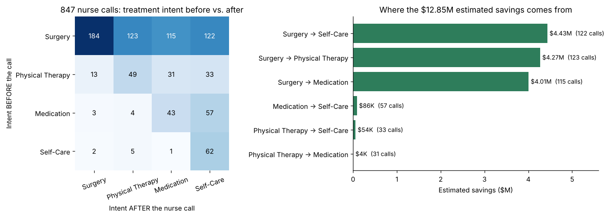
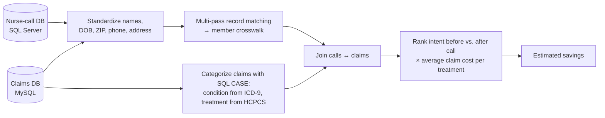

# 🏥 Nurse Line Cost-Savings Analysis

A health plan runs a nurse advice line for members with back, knee, hip and shoulder pain. **Did the calls actually save money?** Answering that meant linking two systems that share no common ID: a **nurse-call database (SQL Server)** and a **medical-claims database (MySQL)**.

**Course:** CIS 450, W. P. Carey School of Business, Arizona State University, Fall 2026
**Stack:** Python · Pandas · SQLAlchemy · SQL Server · MySQL · pandasql · Regex



## Results

| Metric | Value |
|---|---|
| Call-line members matched to claims members | **707 of 735 (96%)** |
| Nurse calls analyzed | 847 |
| Calls where the member moved to a cheaper treatment | **481 (57%)** |
| Estimated total savings | **$12.85M** |
| Average savings per downshifted call | $26.7K |

- **Moving away from surgery** drives about 99% of the savings: on 360 calls, a member who planned surgery chose physical therapy, medication or self-care instead.
- Only 28 calls (3%) moved members to a *more* intensive treatment.
- Savings were re-checked at the member level so follow-up calls aren't double-counted.

## How it works



1. **Pull members from both systems** with SQLAlchemy (SQL Server via pyodbc, MySQL via PyMySQL).
2. **Standardize identity fields** with regex: lowercase and strip punctuation, keep only the first given name, drop suffixes (Jr, Sr, II…), and normalize ZIPs to 5 digits, phones to 10 digits, and addresses to alphanumerics.
3. **Match in passes, strictest rule first:** last + first + DOB → last + first initial + DOB → DOB + ZIP + first initial → phone → address. Each pass only sees records still unmatched, and ambiguous keys are skipped so every match stays one-to-one.
4. **Categorize claims in SQL:** `CASE WHEN` rules map ICD-9 diagnosis text to a body area and HCPCS procedure text to a treatment type (surgery, physical therapy, medication, imaging, office visit…), across inpatient and outpatient claims.
5. **Estimate savings:** rank treatment intensity (Surgery 3, PT 2, Medication 1, Self-Care 0). When a call moves a member down, the saving is the average claim cost of the planned treatment minus the chosen one. Upshifts are floored at zero.

## Repo structure

```
nurse-line-cost-savings/
├── notebooks/nurse_line_cost_savings.ipynb
└── images/
```

## Notes

- The member data is **synthetic** course data hosted on university databases, so it isn't included and notebook outputs are cleared. Connection details are read from environment variables (`CALLDB_SERVER`, `CLAIMS_SERVER`, `CLAIMS_USER`).
- The savings figure is an **estimate**: it assumes members followed their post-call intent and uses average claim cost per treatment type. A next step would be confirming actual treatment from claims dated after each call.
